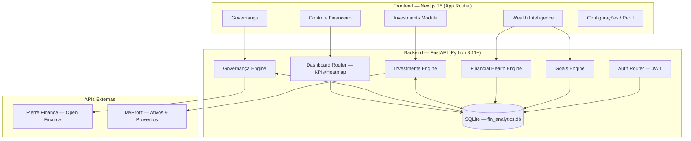

# FinAnalytics — Motor de Inteligência Financeira Privado

> **Sistema de Agregação Patrimonial, Governança Financeira e Wealth Intelligence — Domain-Driven, local-first.**

O FinAnalytics é um motor financeiro privado construído para consolidar dados do **Open Finance (Pierre Finance)** e do **Agregador de Patrimônio (MyProfit)**, transformando transações brutas em inteligência acionável. O sistema oferece controle total sobre despesas, receitas, investimentos, metas e saúde financeira em um único painel.

---

## 🏛️ Arquitetura do Sistema

Duas camadas desacopladas: um **Backend FastAPI** como Source of Truth e proxy inteligente para APIs externas, e um **Frontend Next.js** com design moderno dark/glassmorphism.



---

## 🗺️ Páginas e Rotas da Aplicação

### 📊 Controle Financeiro (domínio `/`)

| Rota              | Título        | Descrição                                                                                 |
| ----------------- | -------------- | ------------------------------------------------------------------------------------------- |
| `/`             | Visão Geral   | KPIs consolidados, Pacing de gastos, Heatmap de transações diárias, resumo de categorias |
| `/transactions` | Transações   | Listagem paginada e filtrada de transações governadas                                     |
| `/categories`   | Categorias     | Agrupamento por categorias com totais e variações                                         |
| `/installments` | Parcelamentos  | Proxy direto para Pierre Finance — faturas e projeções futuras sem poluir o banco        |
| `/cashflow`     | Fluxo de Caixa | Visão de entradas e saídas consolidadas                                                   |

### 💼 Investimentos (domínio `/wealth`)

| Rota                   | Título          | Descrição                                                       |
| ---------------------- | ---------------- | ----------------------------------------------------------------- |
| `/wealth`            | Resumo           | Dashboard consolidado de patrimônio, rentabilidade e aportes     |
| `/wealth/patrimonio` | Patrimônio      | Posições detalhadas de ativos com valor de mercado              |
| `/wealth/allocation` | Alocação       | Distribuição da carteira por classe de ativo (Pizza/Treemap)    |
| `/wealth/dividends`  | Dividendos       | Histórico de proventos recebidos e projeções                   |
| `/wealth/evolution`  | Evolução       | Gráfico histórico de evolução patrimonial                     |
| `/wealth/asset/:id`  | Detalhe do Ativo | Dados completos, performance e histórico de um ativo específico |

### 🧠 Wealth Intelligence (domínio `/wealth-intelligence`)

| Rota                            | Título           | Descrição                                                                        |
| ------------------------------- | ----------------- | ---------------------------------------------------------------------------------- |
| `/wealth-intelligence`        | Dashboard WI      | Hub central com acesso a todos os módulos de inteligência                        |
| `/goals`                      | Metas             | CRUD completo de metas financeiras com progresso, prazo e status                   |
| `/wealth-intelligence/health` | Saúde Financeira | Indicadores de fluxo de caixa, histórico mensal, categorias de gastos e anomalias |

### 🛡️ Governança (domínio `/governance`)

| Rota                     | Título        | Descrição                                                                          |
| ------------------------ | -------------- | ------------------------------------------------------------------------------------ |
| `/governance`          | Visão Geral   | Dashboard de governança — status de sincronização e métricas                    |
| `/governance/classify` | Pierre Finance | Motor de classificação manual — governa transações (Entrada / Saída / Ignorar) |
| `/governance/data`     | MyProfit       | Interface de gestão dos dados de investimentos importados                           |
| `/governance/imports`  | Importações  | Histórico e nova importação de dados externos                                     |
| `/governance/audit`    | Auditoria      | Log imutável de todas as decisões de governança                                   |

### ⚙️ Configurações (domínio `/settings`)

| Rota          | Título         | Descrição                                                                                                            |
| ------------- | --------------- | ---------------------------------------------------------------------------------------------------------------------- |
| `/settings` | Configurações | Segurança (senha), Notificações, Aparência, Exportar/Limpar dados locais                                           |
| `/profile`  | Perfil          | Dados pessoais (nome, nascimento, CPF, telefone) + Dados de trabalho (cargo, empresa, renda bruta, regime tributário) |
| `/accounts` | Contas          | Visão das contas bancárias conectadas via Open Finance, com saldos e tipos                                           |

---

## ✅ Status dos Módulos

### Totalmente Implementados e Funcionais

#### 🔐 Autenticação

- Login com JWT (Access + Refresh Token)
- Sessão persistida em `localStorage`
- Proteção de rotas autenticadas
- Context de autenticação global (`AuthContext`)

#### 📊 Controle Financeiro

- KPIs consolidados: Patrimônio Total, Receitas, Despesas, Saldo Líquido
- **Pacing de Gastos**: ritmo de gasto diário vs. média histórica
- **Heatmap Interativo**: densidade de transações por dia do mês
- Listagem de transações com filtros e paginação
- Agrupamento por categorias com totais e variação percentual
- Parcelamentos via proxy Pierre (projeções sem poluir banco)

#### 🛡️ Governança Financeira

- Motor de classificação manual atômico (Entrada / Saída / Ignorar)
- Preservação dos dados brutos da Pierre Finance (dado cru = sagrado)
- **Audit Log imutável** de todas as decisões de governança
- Interface de gestão MyProfit
- Importador com histórico de importações
- Tela de Reconciliação

#### 💼 Investimentos (V3.1 — Estabilizado)

- Resumo de patrimônio total e rentabilidade
- Posições detalhadas com valor de mercado
- Gráfico de evolução patrimonial histórica
- Alocação por classe de ativo
- Histórico e projeção de dividendos/proventos
- Detalhe de ativo individual com performance
- Integração com **yfinance** para dados de mercado
- Sincronização via MyProfit

#### 🧠 Wealth Intelligence — Goals (Lote 10.1 ✅)

- CRUD completo de metas financeiras
- Tipos: reserva de emergência, imóvel, veículo, viagem, aposentadoria, personalizada
- Progresso visual com barra e percentual
- Status: Ativa / Concluída / Pausada / Cancelada
- Modal lateral de criação/edição (sem tela separada)
- Prioridade: Alta / Média / Baixa
- Prazo e aporte mensal planejado
- API backend completa (`/api/v1/goals`)

#### 🩺 Wealth Intelligence — Saúde Financeira (Lote 10.2 ✅)

- **Cards de KPI**: receitas, despesas, fluxo líquido, taxa de poupança do período
- **Gráfico de barras** de histórico mensal (6 meses mais recentes)
- **Tabela histórica paginada** em ordem **decrescente** (mês mais recente primeiro)
  - Navegação: `← Mais recentes` / `Mais antigos →`
- **Análise por categoria**: top categorias de gasto com variação % mês a mês
- **Detecção de anomalias de gasto**: identifica categorias fora do padrão histórico
- **Tendência por categoria**: evolução gráfica por categoria ao longo do tempo

#### ⚙️ Configurações e Perfil (Redesign Completo)

- **Perfil**: avatar com iniciais, campos editáveis (nome, nascimento, CPF, telefone), dados de trabalho (cargo, empresa, renda bruta, regime tributário, data de início), salvamento em `localStorage`
- **Configurações**: Segurança (troca de senha expansível, 2FA placeholder, sessões), Notificações (toggles), Aparência (tema/idioma), Dados & Sistema (exportar JSON, limpar cache)
- **Contas**: cards coloridos por tipo (🔵 Banco / 🔴 Cartão / 🟢 Investimento / 🟡 Empréstimo / 🟣 Wallet), barra de resumo com saldo total e contagem

#### 🎨 UI/UX Global

- **Logo FinAnalytics**: ícone FA com setas de crescimento (verde→ciano) na sidebar
- **TopNav contextual**: tab ativo com tint de cor por seção
- **Ícones padronizados**: HeartPulse para Saúde, UserCircle para Perfil, Building2 para Contas
- **Wealth Intelligence dashboard**: ícones Lucide nos cards (Target, HeartPulse, Map, Brain, BarChart2, Sparkles)
- Sidebar com logo + "FinAnalytics / Finance OS" com hover effect

---

## 🚧 Roadmap — Wealth Intelligence (Lote 10)

| Fase            | Módulo                                               | Status        |
| --------------- | ----------------------------------------------------- | ------------- |
| **10.0**  | Auditoria arquitetural e estabilização              | ✅ Concluído |
| **10.1**  | Fundação das Metas (CRUD + progresso)               | ✅ Concluído |
| **10.2**  | Saúde Financeira (histórico, anomalias, categorias) | ✅ Concluído |
| **10.3**  | Planejamento: cálculos, projeções e simulações   | ✅ Validated / Closed |
| **10.4**  | Aposentadoria / FIRE / Independência Financeira      | 🟢 Ready / Not Started |
| **10.5**  | Inteligência da Carteira (análise de posições)    | ⏳ Pendente   |
| **10.6**  | Alocação, Rebalanceamento e Watchlist               | ⏳ Pendente   |
| **10.7**  | Mercado, Notícias e Radar de Oportunidades           | ⏳ Pendente   |
| **10.8**  | Ollama / LLM / IA local                               | ⏳ Pendente   |
| **10.9**  | Wealth Copilot / Briefing Inteligente                 | ⏳ Pendente   |
| **10.10** | Multi-Agent avançado                                 | ⏳ Pendente   |
| **10.11** | Docker / Operação / Infraestrutura                  | ⏳ Pendente   |
| **10.12** | UX global / Acabamento final                          | ⏳ Pendente   |

**Pós-10.3 UX:** ✅ Validated / Closed

---

## 🔌 API Backend — Endpoints Ativos

### Autenticação

| Método  | Rota                     | Descrição                           |
| -------- | ------------------------ | ------------------------------------- |
| `POST` | `/api/v1/auth/login`   | Login com e-mail e senha, retorna JWT |
| `POST` | `/api/v1/auth/refresh` | Renovação do Access Token           |

### Controle Financeiro

| Método | Rota                            | Descrição                       |
| ------- | ------------------------------- | --------------------------------- |
| `GET` | `/api/v1/accounts`            | Lista contas conectadas           |
| `GET` | `/api/v1/transactions`        | Lista transações governadas     |
| `GET` | `/api/v1/categories`          | Lista categorias com totais       |
| `GET` | `/api/v1/dashboard/kpis`      | KPIs consolidados do período     |
| `GET` | `/api/v1/dashboard/pacing`    | Ritmo de gastos diário           |
| `GET` | `/api/v1/dashboard/heatmap`   | Densidade de transações por dia |
| `GET` | `/api/v1/pierre/installments` | Proxy: parcelamentos Pierre       |

### Governança

| Método      | Rota                           | Descrição                     |
| ------------ | ------------------------------ | ------------------------------- |
| `GET/POST` | `/api/v1/governance/...`     | Motor de classificação Pierre |
| `GET`      | `/api/v1/governance/audit`   | Log imutável de auditoria      |
| `POST`     | `/api/v1/governance/imports` | Importar dados MyProfit/Pierre  |

### Investments

| Método | Rota                                | Descrição                       |
| ------- | ----------------------------------- | --------------------------------- |
| `GET` | `/api/v1/investments/positions`   | Posições de ativos              |
| `GET` | `/api/v1/investments/evolution`   | Evolução patrimonial histórica |
| `GET` | `/api/v1/investments/allocation`  | Alocação por classe             |
| `GET` | `/api/v1/investments/dividends`   | Histórico de proventos           |
| `GET` | `/api/v1/investments/performance` | Performance da carteira           |

### Wealth Intelligence

| Método            | Rota                                    | Descrição                            |
| ------------------ | --------------------------------------- | -------------------------------------- |
| `GET`            | `/api/v1/financial-health/summary`    | Resumo de saúde financeira            |
| `GET`            | `/api/v1/financial-health/history`    | Histórico mensal de receitas/despesas |
| `GET`            | `/api/v1/financial-health/categories` | Análise por categoria com tendências |
| `GET`            | `/api/v1/financial-health/anomalies`  | Detecção de anomalias de gasto       |
| `GET/POST`       | `/api/v1/goals`                       | Listar / Criar metas                   |
| `GET/PUT/DELETE` | `/api/v1/goals/:id`                   | Obter / Editar / Excluir meta          |

---

## ⚙️ Como Executar o Projeto

### Pré-requisitos

- **Node.js** v18+
- **Python** 3.11+
- **npm** (incluído no Node.js)

### Variáveis de ambiente

Copie `.env.example` para `.env` na raiz e preencha as credenciais das APIs externas.

### Backend (porta 8080)

```bash
# Na raiz do projeto
python -m venv .venv
.venv\Scripts\activate          # Windows
# source .venv/bin/activate     # Linux/Mac

pip install -r requirements.txt
uvicorn backend.main:app --reload --port 8080
```

### Frontend (porta 3000)

```bash
cd frontend
npm install          # apenas na primeira vez
npm run dev
```

Acesse: **http://localhost:3000**

### Testes

```bash
pytest tests/unit/
```

---

## 📂 Estrutura de Diretórios

```text
fin_analytics_v2/
├── backend/
│   ├── api/
│   │   ├── routers/           # Endpoints REST (auth, dashboard, investments,
│   │   │                      #   financial_health, goals, governance, transactions)
│   │   └── dependencies/      # Injeção de dependências (auth guard, db session)
│   ├── application/           # DTOs, Use Cases, Serviços de Integração
│   ├── core/                  # Configurações globais (settings, logging)
│   ├── database/              # Engine SQLite, sessões, repositórios, base ORM
│   ├── domain/                # Entidades e regras de negócio puras
│   ├── domains/
│   │   └── pierre/            # Domínio Pierre Finance (importação, governança,
│   │                          #   classificação, audit log, parcelamentos)
│   └── infrastructure/        # Integrações externas (MyProfit, yfinance)
├── database/
│   ├── migrations/            # Scripts SQL de migração (Alembic + versionados)
│   └── fin_analytics.db       # Banco SQLite local
├── docs/                      # ADRs, regras de domínio, logs de decisão
├── frontend/
│   └── src/
│       ├── app/               # Rotas Next.js (App Router)
│       │   ├── (root)         # / — Visão Geral (dashboard)
│       │   ├── transactions/  # Transações
│       │   ├── categories/    # Categorias
│       │   ├── installments/  # Parcelamentos
│       │   ├── cashflow/      # Fluxo de Caixa
│       │   ├── wealth/        # Módulo Investments completo
│       │   ├── wealth-intelligence/
│       │   │   └── health/    # Saúde Financeira
│       │   ├── goals/         # Metas Financeiras
│       │   ├── governance/    # Governança (classify, data, imports, audit)
│       │   ├── settings/      # Configurações (segurança, aparência, dados)
│       │   ├── profile/       # Perfil pessoal + dados de trabalho
│       │   ├── accounts/      # Contas conectadas
│       │   └── login/         # Tela de autenticação
│       ├── components/
│       │   ├── layout/        # AppShell, TopNav, PageLayout
│       │   ├── dashboard/     # Componentes do painel financeiro
│       │   ├── wealth/        # Componentes do módulo Investments
│       │   ├── governance/    # Componentes de Governança
│       │   └── ui/            # Primitivos de UI (shadcn/ui)
│       ├── config/
│       │   └── navigation.ts  # SIDEBAR_NAV, SECTION_TABS, TAB_COLORS
│       ├── contexts/
│       │   └── AuthContext.tsx # Sessão JWT global
│       ├── hooks/             # 18 hooks customizados (useAccounts, useGoals,
│       │                      #   useAllocationData, useDividendsData, etc.)
│       ├── lib/               # Utilitários (api fetcher, formatters, cn)
│       └── types/             # TypeScript: entidades, DTOs
├── scripts/                   # Scripts de setup, reset de DB, testes isolados
├── tests/                     # Suíte de testes automatizados
├── ESPECIFICACAO_PRODUTO_METAS.md  # Visão do produto Wealth Intelligence (Lote 10)
└── requirements.txt
```

---

## 🎨 Stack Tecnológica

### Frontend

| Tecnologia                        | Uso                                                      |
| --------------------------------- | -------------------------------------------------------- |
| **Next.js 15** (App Router) | Framework React com SSR e roteamento baseado em arquivos |
| **TypeScript**              | Tipagem estática de ponta a ponta                       |
| **Tailwind CSS v4**         | Utilitários de estilo (dark theme, glassmorphism)       |
| **Recharts**                | Gráficos de barras, linhas, pizza, área                |
| **Lucide React**            | Biblioteca de ícones consistente                        |
| **shadcn/ui**               | Primitivos de UI acessíveis (Dialog, Button, etc.)      |

### Backend

| Tecnologia            | Uso                                               |
| --------------------- | ------------------------------------------------- |
| **FastAPI**     | Framework web assíncrono com OpenAPI automático |
| **SQLAlchemy**  | ORM com modelos separados por domínio            |
| **SQLite**      | Banco de dados local (single-file, zero-config)   |
| **Alembic**     | Migrações versionadas de banco                  |
| **Pydantic v2** | Validação e serialização de DTOs              |
| **yfinance**    | Dados de mercado para o módulo Investments       |
| **python-jose** | Geração e validação de JWT                    |

---

## 🧩 Princípios de Arquitetura

1. **Dado cru é sagrado**: dados brutos da Pierre Finance nunca são modificados; governança opera em uma camada separada com Audit Log imutável.
2. **Backend calcula. Banco governa. IA interpreta.** (futuro) — separação clara entre fonte da verdade e camadas de inteligência.
3. **Read Models**: endpoints de leitura retornam modelos já agregados e calculados, prontos para consumo direto pela UI.
4. **Local-first**: banco SQLite local para máxima performance e privacidade; sem dependência de cloud para dados pessoais.
5. **Proxy inteligente**: parcelamentos e cotações são servidos via proxy sem persistência local, evitando dados projetados no banco.

---

## 🐛 Dívida Técnica Conhecida

- O pipeline de importação Pierre usa o adapter legado (`LegacyBase`) porque a Governança opera sobre o schema legado. Coexistência temporária até migração planejada.
- Dados de perfil estendido (cargo, renda, CPF, etc.) persistem em `localStorage`. Persistência via `PATCH /users/me/profile` está planejada para fase futura.
- As seções de Notificações, 2FA e Aparência no `/settings` são placeholders visuais (toggles não têm efeito persistente ainda).

---

## 📋 Visão de Produto — Wealth Intelligence

O objetivo final do Wealth Intelligence é transformar dados financeiros em um **centro inteligente de planejamento pessoal**, capaz de responder:

> *"Quanto tenho? Como estou? Estou evoluindo? Minhas metas estão no caminho certo? Quanto preciso investir? Quando poderei me aposentar? O que minha carteira diz sobre mim?"*

Consulte [`ESPECIFICACAO_PRODUTO_METAS.md`](./ESPECIFICACAO_PRODUTO_METAS.md) para a visão detalhada do produto, roadmap completo (Lotes 10.0–10.12) e definição de pronto.

---

*FinAnalytics — Motor Financeiro Privado. Todos os dados permanecem locais.*
