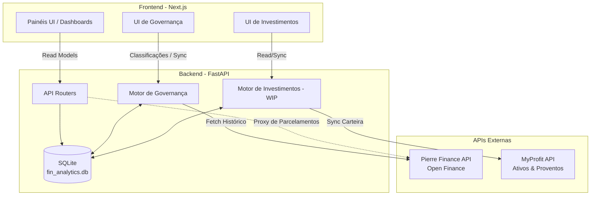

# Fin Analytics

**Sistema de Inteligência Financeira e Agregação Patrimonial (Domain-Driven)**

O Fin Analytics é um motor financeiro local altamente performático construído para consolidar dados do **Open Finance (Pierre Finance)** e **Agregadores de Patrimônio (MyProfit)**. Ele fornece um painel de controle completo para despesas, receitas, projeções e investimentos.

---

## 🏛️ Arquitetura do Sistema

O sistema é dividido em duas camadas principais: um **Backend (FastAPI)** que funciona como Source of Truth e Proxy para APIs de terceiros, e um **Frontend (Next.js)** altamente reativo com design em _glassmorphism_.



---

## 🚀 Status dos Módulos

### ✅ 1. Controle Financeiro & Governança (Totalmente Implementado)
O módulo principal de fluxo de caixa e gestão de despesas está 100% funcional, conectado à base de dados local e integrado ao Open Finance.

* **Governança Financeira (`/governance`)**: Motor de classificação manual atômico. Preserva os dados crus da Pierre Finance e mantém um Audit Log (Histórico de Auditoria) imutável de todas as decisões (Entrada, Saída, Ignorar).
* **Visão Geral (`/`)**: KPIs financeiros consolidados, análise de Ritmo de Gastos (*Pacing*) e um **Mapa de Calor (Heatmap)** interativo para densidade de transações diárias.
* **Transações & Categorias (`/transactions`, `/categories`)**: Agrupamento por categorias dinâmicas, com filtros nativos e relatórios de fluxo de caixa baseados nos dados já governados.
* **Parcelamentos (`/installments`)**: Atua como um Proxy direto para a API da Pierre, projetando faturas e parcelas futuras em tempo real sem "sujar" o banco de dados com dados projetados.
* **Configurações (`/settings`)**: Lista de Contas Bancárias ativas conectadas via Open Finance, listadas dinamicamente via API.

### 🚧 2. Gestão de Patrimônio & Investimentos (Frontend Pronto, Backend Pendente)
A UI de investimentos (módulo `wealth`) já possui o design completo e responsivo, restando apenas a implementação das lógicas de negócio e banco de dados no backend.

**Funcionalidades Pendentes de Implementação (Roadmap):**
- [ ] `GET /api/v1/wealth/positions`: Consolidado de posições de ativos.
- [ ] `GET /api/v1/wealth/dividends`: Histórico e projeção de proventos.
- [ ] `GET /api/v1/wealth/evolution`: Gráfico de evolução patrimonial histórica.
- [ ] `GET /api/v1/wealth/allocation`: Pizza de alocação de carteira (Ações, FIIs, Renda Fixa).
- [ ] `POST /api/v1/wealth/sync`: Importador/Sincronizador dos dados da MyProfit para a base local.
- [ ] **Reconciliação**: Cruzamento de saldos da corretora (MyProfit) com os saldos em conta (Pierre Finance).

---

## ⚙️ Como Executar o Projeto

### Pré-requisitos
- **Node.js** (v18+)
- **Python** (3.11+)
- **NPM** ou **Yarn**

### Passo 1: Configuração do Banco de Dados
A pasta `database/` armazena o banco de dados SQLite (`fin_analytics.db`). As credenciais e chaves das APIs externas devem ser inseridas no arquivo `.env` na raiz do projeto (use o `.env.example` como base).

### Passo 2: Iniciando o Backend
Abra um terminal na raiz do projeto:
```bash
# Crie e ative seu ambiente virtual (opcional, mas recomendado)
python -m venv .venv
# Ativação no Windows:
.venv\Scripts\activate

# Instale as dependências
pip install -r requirements.txt

# Inicie o servidor FastAPI (Porta 8080)
uvicorn backend.main:app --reload --port 8080
```

### Passo 3: Iniciando o Frontend
Abra um segundo terminal, entre na pasta do frontend e inicie o Next.js:
```bash
cd frontend

# Instale os pacotes (apenas na primeira vez)
npm install

# Inicie o servidor de desenvolvimento (Porta 3000)
npm run dev
```

A aplicação estará disponível em `http://localhost:3000`.

### Testes

Para executar a suíte oficial de testes do projeto (baseline validado):
```bash
pytest tests/unit/
```

### Dívida Técnica Conhecida (Pipeline Pierre)

O fluxo oficial de importação Pierre utiliza o adapter legado porque a Governança atual opera sobre o schema legado. Existe coexistência temporária entre infraestrutura canônica e models legados (`LegacyBase`). O legado permanece como fonte operacional da Governança até futura migração planejada.

---

## 📂 Estrutura de Diretórios (Padrão Enterprise)

```text
fin_analytics/
├── backend/            # Lógica de negócio, APIRouters, FastAPI
│   ├── api/            # Dependências, middlewares e roteadores
│   ├── application/    # DTOs, Use Cases, Serviços de Integração
│   ├── core/           # Configurações gerais e Injeção de Dependências
│   ├── database/       # Conexão com SQLite, Sessões e Repositórios
│   └── domains/        # Domínios de Negócio (Pierre, Wealth)
├── database/           # Scripts SQL, migrations (Alembic) e o fin_analytics.db
├── docs/               # Documentação profunda (ADRs, Regras, Logs)
├── frontend/           # Aplicação Next.js (React)
│   ├── src/app/        # Rotas da aplicação (App Router)
│   ├── src/components/ # Componentes reutilizáveis (Layout, UI)
│   └── src/lib/        # Utils, Fetchers da API, formatação
├── scripts/            # Scripts secundários (Setup, Resets de DB, Testes isolados)
└── tests/              # Suíte de testes automatizados e arquivos (Archive)
```