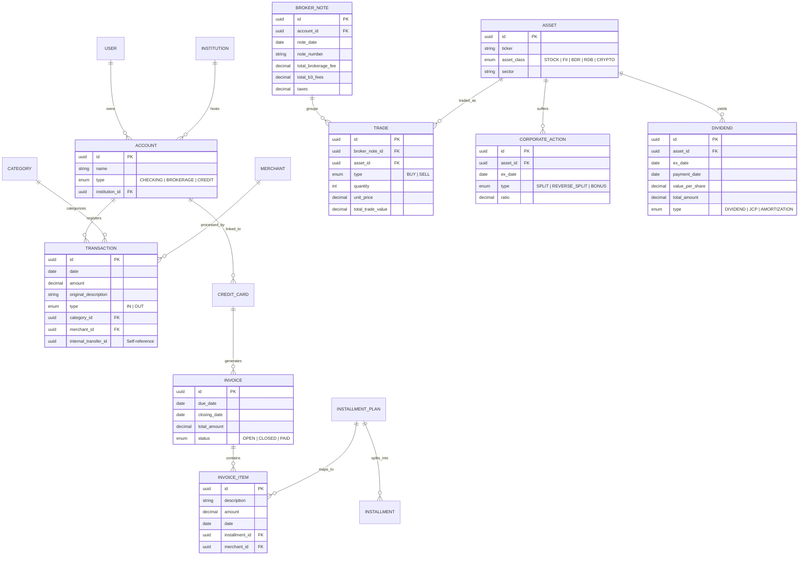

# Modelo Definitivo do Domínio Financeiro (Final Domain Model V3)

Este documento representa a fundação arquitetônica de dados para o FinAnalytics V3. Projetado para suportar os próximos 10 anos de operação sem legados, ignorando dependências de serviços terceiros (Pierre/MyProfit), garantindo um Ledger puro e cálculos dinâmicos de investimentos.

---

## Arquitetura em Diagrama de Domínio (Mermaid)

---

## Descrição dos Contextos Delimitados (Bounded Contexts)

### 1. Contexto de Ledger (Core Finance)
Garante a integridade financeira por meio da imutabilidade.
* A entidade `TRANSACTION` é o coração do sistema. Representa qualquer saída ou entrada de dinheiro na conta `CHECKING`.
* As tabelas `MERCHANT` e `CATEGORY` pertencem a um sub-motor de IA/Classificação que limpa e entende dados automaticamente no momento da ingestão (via webhook, OFX ou CSV do banco), matando a necessidade do "Pierre".
* O campo `internal_transfer_id` anula contabilidade duplicada quando o usuário transfere da conta Nubank para a conta NuInvest. O saldo patrimonial geral não é afetado.

### 2. Contexto de Crédito (Credit Management)
Lida com dinheiro tomado emprestado.
* O cartão gera faturas mensais (`INVOICE`).
* Compras geram despesas pontuais (`INVOICE_ITEM`).
* Compras parceladas geram um `INSTALLMENT_PLAN`, que se desdobra em N `INSTALLMENTS`, alocados inteligentemente em `INVOICES` futuras, permitindo previsibilidade total do passivo financeiro em D+30, D+60.

### 3. Contexto de Mercado (Wealth Trading & Asset)
Garante exatidão matemática do imposto de renda e rentabilidade real, matando o MyProfit.
* Trabalha 100% com dados puros da B3: A `BROKER_NOTE` (Nota de Corretagem) registra o "Ato da Negociação", contendo a matemática das taxas macro.
* O `TRADE` guarda o detalhe (Comprei 10 VALE3 a R$ 70). O backend usa essas duas tabelas, aliadas as `CORPORATE_ACTIONS`, para construir as tabelas agregadas e visões (Materialized Views) do **Preço Médio** no decorrer do tempo.
* O componente de `yfinance` agirá externamente como um serviço, preenchendo as tabelas de `MARKET_DATA` que não foram diagramadas acima por serem *Time Series* acopladas diretamente à tabela `ASSET`.

## Princípios de Ouro do Domínio V3
1. **Nada de Saldos Estáticos Corrigidos a Mão:** Saldos de banco e médias de preço são **derivados** de um somatório imutável de eventos (`Transations` e `Trades`).
2. **Total Independência (Zero Vendor Lock-in):** A abstração está a nível de liquidação B3 e Extrato Brasileiro. O sistema será imune à descontinuidade de plataformas como MyProfit, StatusInvest, Trademap ou Pierre.
3. **Auditabilidade Total:** Uma transação será rastreável desde a nota de corretagem em PDF original até a cota de rentabilidade TWR no dashboard final.
