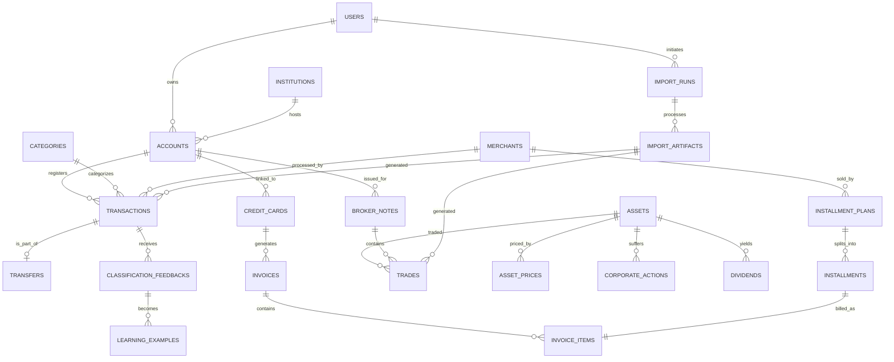

# 2. ERD e Schema SQL Definitivos

Este documento cobre a **Etapa 3** e os **Entregáveis 2 e 3** do FinAnalytics V3.

---

## 1. Entity Relationship Diagram (ERD) - Mermaid



---

## 2. Schema SQL PostgreSQL Definitivo

A modelagem reflete 100% de normalização e performance para os próximos 10 anos, utilizando UUIDs para evitar colisão e facilitar idempotência.

```sql
-- ==========================================
-- 1. CORE & BANKING
-- ==========================================
CREATE TABLE users (
    id UUID PRIMARY KEY DEFAULT gen_random_uuid(),
    email VARCHAR(255) UNIQUE NOT NULL,
    created_at TIMESTAMP WITH TIME ZONE DEFAULT NOW()
);

CREATE TABLE institutions (
    id UUID PRIMARY KEY DEFAULT gen_random_uuid(),
    code VARCHAR(50) UNIQUE NOT NULL, -- Ex: 0260, B3
    name VARCHAR(255) NOT NULL,
    type VARCHAR(50) NOT NULL -- BANK, BROKER
);

CREATE TABLE accounts (
    id UUID PRIMARY KEY DEFAULT gen_random_uuid(),
    user_id UUID REFERENCES users(id) ON DELETE CASCADE,
    institution_id UUID REFERENCES institutions(id),
    name VARCHAR(255) NOT NULL,
    type VARCHAR(50) NOT NULL, -- CHECKING, CREDIT, BROKERAGE
    currency VARCHAR(3) DEFAULT 'BRL',
    created_at TIMESTAMP WITH TIME ZONE DEFAULT NOW()
);

-- ==========================================
-- 2. CASHFLOW (LEDGER)
-- ==========================================
CREATE TABLE categories (
    id UUID PRIMARY KEY DEFAULT gen_random_uuid(),
    parent_id UUID REFERENCES categories(id),
    name VARCHAR(255) NOT NULL,
    type VARCHAR(50) NOT NULL -- EXPENSE, INCOME, TRANSFER, INVESTMENT
);

CREATE TABLE merchants (
    id UUID PRIMARY KEY DEFAULT gen_random_uuid(),
    name VARCHAR(255) NOT NULL UNIQUE,
    normalized_name VARCHAR(255) NOT NULL
);

CREATE TABLE transactions (
    id UUID PRIMARY KEY, -- Idempotent ID from Bank (Hash ou UUID original)
    account_id UUID REFERENCES accounts(id) ON DELETE CASCADE,
    merchant_id UUID REFERENCES merchants(id),
    category_id UUID REFERENCES categories(id),
    date DATE NOT NULL,
    amount DECIMAL(15, 4) NOT NULL,
    type VARCHAR(10) NOT NULL, -- IN, OUT
    original_description TEXT NOT NULL,
    is_ignored BOOLEAN DEFAULT FALSE,
    created_at TIMESTAMP WITH TIME ZONE DEFAULT NOW()
);

CREATE TABLE transfers (
    id UUID PRIMARY KEY DEFAULT gen_random_uuid(),
    out_transaction_id UUID REFERENCES transactions(id) UNIQUE NOT NULL,
    in_transaction_id UUID REFERENCES transactions(id) UNIQUE NOT NULL,
    fee_amount DECIMAL(15, 4) DEFAULT 0
);

-- ==========================================
-- 3. CREDIT CARD
-- ==========================================
CREATE TABLE credit_cards (
    id UUID PRIMARY KEY DEFAULT gen_random_uuid(),
    account_id UUID REFERENCES accounts(id) ON DELETE CASCADE,
    name VARCHAR(255) NOT NULL,
    closing_day INT NOT NULL,
    due_day INT NOT NULL
);

CREATE TABLE invoices (
    id UUID PRIMARY KEY DEFAULT gen_random_uuid(),
    credit_card_id UUID REFERENCES credit_cards(id),
    closing_date DATE NOT NULL,
    due_date DATE NOT NULL,
    total_amount DECIMAL(15, 4) NOT NULL,
    status VARCHAR(20) NOT NULL -- OPEN, CLOSED, PAID
);

CREATE TABLE installment_plans (
    id UUID PRIMARY KEY DEFAULT gen_random_uuid(),
    credit_card_id UUID REFERENCES credit_cards(id),
    merchant_id UUID REFERENCES merchants(id),
    purchase_date DATE NOT NULL,
    total_amount DECIMAL(15, 4) NOT NULL,
    total_installments INT NOT NULL
);

CREATE TABLE installments (
    id UUID PRIMARY KEY DEFAULT gen_random_uuid(),
    installment_plan_id UUID REFERENCES installment_plans(id) ON DELETE CASCADE,
    installment_number INT NOT NULL,
    amount DECIMAL(15, 4) NOT NULL,
    expected_invoice_date DATE NOT NULL
);

CREATE TABLE invoice_items (
    id UUID PRIMARY KEY DEFAULT gen_random_uuid(),
    invoice_id UUID REFERENCES invoices(id) ON DELETE CASCADE,
    installment_id UUID REFERENCES installments(id),
    merchant_id UUID REFERENCES merchants(id),
    description VARCHAR(255) NOT NULL,
    amount DECIMAL(15, 4) NOT NULL,
    date DATE NOT NULL
);

-- ==========================================
-- 4. INVESTMENTS
-- ==========================================
CREATE TABLE assets (
    id UUID PRIMARY KEY DEFAULT gen_random_uuid(),
    ticker VARCHAR(20) UNIQUE NOT NULL,
    asset_class VARCHAR(50) NOT NULL, -- STOCK, FII, RDB, CRYPTO
    sector VARCHAR(100)
);

CREATE TABLE broker_notes (
    id UUID PRIMARY KEY DEFAULT gen_random_uuid(),
    account_id UUID REFERENCES accounts(id),
    note_number VARCHAR(50) NOT NULL,
    note_date DATE NOT NULL,
    clearing_fee DECIMAL(15, 4) DEFAULT 0,
    registration_fee DECIMAL(15, 4) DEFAULT 0,
    brokerage_fee DECIMAL(15, 4) DEFAULT 0,
    taxes DECIMAL(15, 4) DEFAULT 0,
    UNIQUE(account_id, note_number, note_date)
);

CREATE TABLE trades (
    id UUID PRIMARY KEY DEFAULT gen_random_uuid(),
    broker_note_id UUID REFERENCES broker_notes(id) ON DELETE CASCADE,
    asset_id UUID REFERENCES assets(id),
    type VARCHAR(10) NOT NULL, -- BUY, SELL
    quantity DECIMAL(15, 8) NOT NULL,
    unit_price DECIMAL(15, 4) NOT NULL,
    total_value DECIMAL(15, 4) NOT NULL
);

CREATE TABLE corporate_actions (
    id UUID PRIMARY KEY DEFAULT gen_random_uuid(),
    asset_id UUID REFERENCES assets(id),
    type VARCHAR(50) NOT NULL, -- SPLIT, REVERSE_SPLIT, BONUS
    ex_date DATE NOT NULL,
    ratio DECIMAL(15, 8) NOT NULL -- Ex: 4 para 1 -> 4.0
);

CREATE TABLE dividends (
    id UUID PRIMARY KEY DEFAULT gen_random_uuid(),
    asset_id UUID REFERENCES assets(id),
    type VARCHAR(50) NOT NULL, -- DIVIDEND, JCP, AMORTIZATION
    ex_date DATE NOT NULL,
    payment_date DATE NOT NULL,
    value_per_share DECIMAL(15, 8) NOT NULL,
    total_amount DECIMAL(15, 4) NOT NULL
);

-- ==========================================
-- 5. MARKET DATA & ANALYTICS
-- ==========================================
CREATE TABLE asset_prices (
    asset_id UUID REFERENCES assets(id),
    date DATE NOT NULL,
    close_price DECIMAL(15, 4) NOT NULL,
    PRIMARY KEY(asset_id, date)
);

CREATE TABLE benchmark_prices (
    ticker VARCHAR(20) NOT NULL, -- IBOV, CDI, IPCA
    date DATE NOT NULL,
    value DECIMAL(15, 6) NOT NULL,
    PRIMARY KEY(ticker, date)
);

CREATE TABLE portfolio_snapshots (
    user_id UUID REFERENCES users(id),
    date DATE NOT NULL,
    total_equity DECIMAL(15, 4) NOT NULL,
    cost_basis DECIMAL(15, 4) NOT NULL,
    daily_twr DECIMAL(10, 6) NOT NULL,
    cumulative_twr DECIMAL(10, 6) NOT NULL,
    PRIMARY KEY(user_id, date)
);

-- ==========================================
-- 6. GOVERNANCE & AI
-- ==========================================
CREATE TABLE import_runs (
    id UUID PRIMARY KEY DEFAULT gen_random_uuid(),
    user_id UUID REFERENCES users(id),
    run_date TIMESTAMP WITH TIME ZONE DEFAULT NOW(),
    source VARCHAR(50) NOT NULL, -- NUBANK_CSV, B3_PDF
    status VARCHAR(20) NOT NULL -- SUCCESS, FAILED
);

CREATE TABLE classification_rules (
    id UUID PRIMARY KEY DEFAULT gen_random_uuid(),
    regex_pattern VARCHAR(500) NOT NULL,
    merchant_id UUID REFERENCES merchants(id),
    category_id UUID REFERENCES categories(id),
    priority INT DEFAULT 0
);

CREATE TABLE learning_examples (
    id UUID PRIMARY KEY DEFAULT gen_random_uuid(),
    original_description VARCHAR(500) NOT NULL,
    merchant_id UUID REFERENCES merchants(id),
    category_id UUID REFERENCES categories(id),
    embedding VECTOR(384) -- pgvector required
);
```
