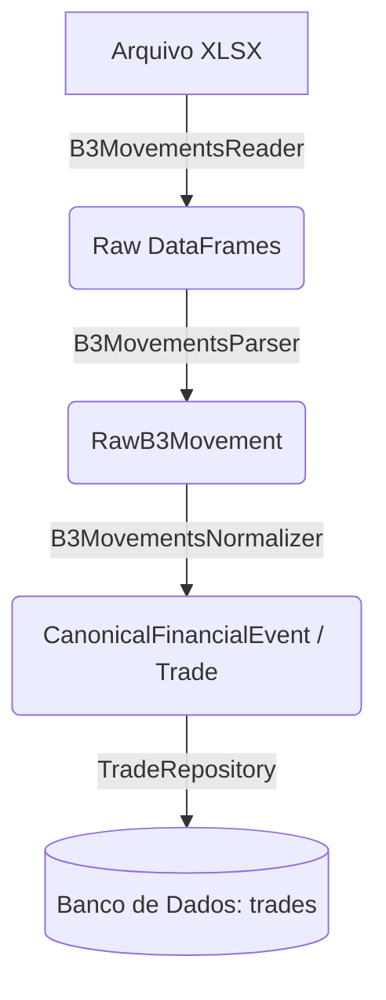

# CEI Pipeline Functional Specification (Etapa 6)

Este documento descreve exatamente o trânsito do pipeline para o arquivo `Exemplo_Negociacao_B3.xlsx`, desde o disco até o banco de dados. Este é um contrato puramente teórico; nenhum código acompanha esta sprint.

## Arquitetura E2E: Fluxo Funcional (Read-Only)

### 1. B3MovementsReader (Camada de Ingestão Física)
- **Entrada:** Caminho do arquivo físico (ex: `samples/Exemplo_Negociacao_B3.xlsx`).
- **Responsabilidades:** Iniciar a engine `openpyxl`, isolar exclusivamente a aba nomeada `Negociação` (ignorando qualquer outra aba).
- **Validações:** Verificar se o arquivo possui a aba `Negociação`. Caso não, emitir erro claro sem tentar mascarar.
- **Saída:** Objeto `pandas.DataFrame` contendo 100% das linhas e colunas nativas.
- **Erros Possíveis:** `FileNotFoundError`, `ValueError` (aba não encontrada), falha de enconding.

### 2. B3MovementsParser (Camada de Tipagem Fraca)
- **Entrada:** `pandas.DataFrame`.
- **Responsabilidades:** Padronizar nomes de colunas via dicionário mapeado (remover acentos e espaços), converter hífens (`-`) para `NaN`/`None`, remover espaços em branco, varrer linhas onde a chave principal (`Código de Negociação`) está nula.
- **Validações:** Verificar se as colunas mínimas exigíveis no `TRADE_MAPPING_MATRIX.md` estão presentes.
- **Saída:** Lista de DTOs Fracos (ex: `RawB3Movement`), onde as propriedades ainda são strings/floats básicos.
- **Erros Possíveis:** `ValidationError` (Pydantic acusando formato impossível), `KeyError` (coluna da B3 mudou de nome).

### 3. B3MovementsNormalizer (Camada de Regra de Negócio CEI)
- **Entrada:** Objeto `RawB3Movement`.
- **Responsabilidades:**
  1. Identificar se o Ticker pertence ao mercado fracionário (termina com `F`) e cortar esse sufixo.
  2. Converter Strings (`Compra`, `Venda`) no Enum interno `TradeType.BUY`, `TradeType.SELL`.
  3. Gerar a Chave de Idempotência `MD5` atestando o registro como único.
- **Validações:** Impedir preços ou quantidades negativas.
- **Saída:** Objeto canônico persistível (`Trade` ou `CanonicalFinancialEvent`).
- **Erros Possíveis:** Falha de Enum (tipo de movimentação não mapeado, ex: "Subscrição").

### 4. TradeRepository (Camada de Persistência)
- **Entrada:** Lista de objetos `Trade`.
- **Responsabilidades:** Conectar ao banco e aplicar operação Upsert (Insert Or Update) massiva na tabela alvo, baseando-se na chave de idempotência (Hash).
- **Validações:** Garantir a atomicidade (`session.begin()`).
- **Saída:** Número de registros inseridos/atualizados.
- **Erros Possíveis:** Falha de Constraint (Unique Key Violation) se o hash falhar; `OperationalError` (banco fora do ar).
