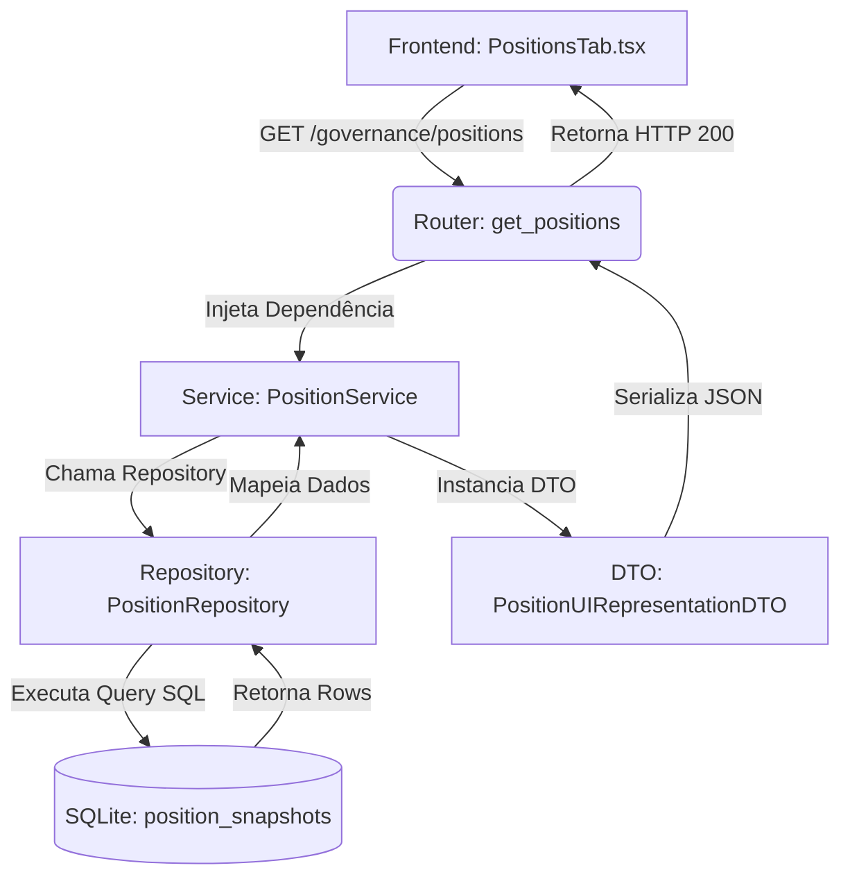

# FLUXO DE DADOS (DATA FLOW) - SPRINT H1

Este documento mapeia o caminho exato que o dado percorre dentro da arquitetura da Governança. Ele serve como o guia absoluto de rastreamento de bugs e de responsabilidade de camadas.

## 1. Fluxo: Listagem de Posições Consolidadas



## 2. Fluxo: Assistente de Nova Importação (UX Wizard)

```mermaid
flowchart TD
    A[Frontend: Wizard] -->|Seleciona Origem e Arquivo| B[POST /governance/imports/upload]
    B --> C[ImportService: process_import]
    C --> D[Reader: Ex: NubankReader]
    D --> E[Parser]
    E --> F[Validator]
    F --> G[Normalizer]
    G --> H[Artifact]
    H -->|Preview no Front| I[Confirmação do Usuário]
    I --> J[POST /governance/imports/{run_id}/confirm]
    J --> K[Repository: TransactionRepository / PositionRepository]
    K --> L[(SQLite: Tabelas Finais)]
```

## 3. Princípio da Camada Única
Em caso de anomalia, o rastreamento deve seguir a ordem das setas acima. Se uma seta foi pulada (ex: Router comunicando com SQLite diretamente), existe uma **Quebra Arquitetural** passível de correção sumária.
