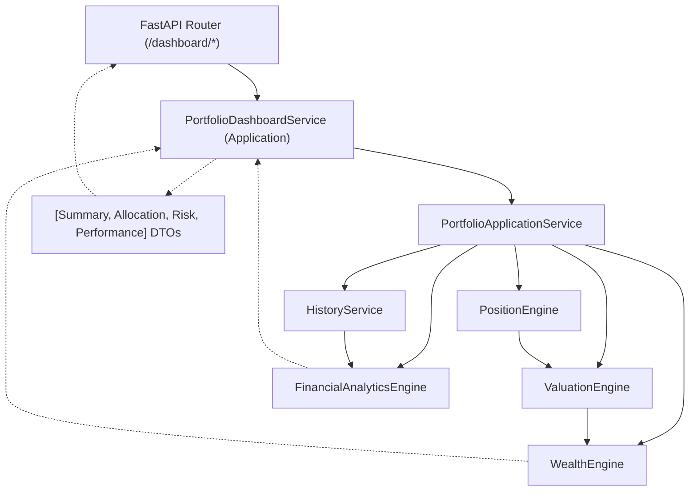

# Dashboard Architecture

O Dashboard arquiteturalmente representa o limite da nossa **Presentation Layer** para os dados da Riqueza Global do Investidor.

## Fluxo de Processamento e Injeção

## Regras Consolidadas
1. **Zero Lógica Financeira:** O Dashboard não calcula (Ex: não pode somar o montante aportado para ver lucro). Ele apenas usa os agregados emitidos pelos Serviços Internos.
2. **Separação por Facetas:** A arquitetura do Dashboard é segregada em facetas independentes para que o Frontend possa carregar a interface progressivamente e de forma assíncrona.
3. **Dependency Injection:** O Router obtém o `PortfolioDashboardService` instanciado via `ApplicationFactory`, passando para este o `PortfolioApplicationService`.
