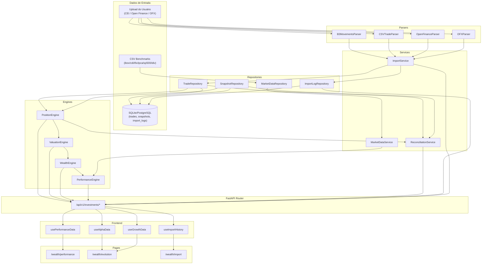

# Dependency Graph — Gate 10.5

Data: 2026-07-13

## Grafo Completo de Dependências



## Verificação de Dependências Circulares

| Módulo A | Módulo B | Circular? | Detalhe |
|----------|----------|-----------|---------|
| `PerformanceEngine` | `PositionEngine` | Não | PE importa PosEng internamente (sentido único) |
| `Router` | `Engines` | Não | Router chama engines, engines não conhecem o router |
| `Services` | `Repositories` | Não | Services dependem de Repos, nunca o contrário |
| `MarketDataService` | `MarketDataRepository` | Não | Service usa Repo como dependência |
| `PerformanceEngine` | `MarketDataService` | Não | PE importa MDS localmente (sentido único) |

**Conclusão**: Nenhuma dependência circular detectada no grafo atual.

## Camadas de Abstração

```
┌──────────────────────────────────────────────────────┐
│  FRAMEWORK (FastAPI, SQLAlchemy, Pandas)             │
├──────────────────────────────────────────────────────┤
│  INTERFACE ADAPTERS (Router)                         │
├──────────────────────────────────────────────────────┤
│  SERVICES (ImportService, MarketDataService,         │
│            ReconciliationService)                    │
├──────────────────────────────────────────────────────┤
│  ENGINES (PositionEngine, ValuationEngine,           │
│           WealthEngine, PerformanceEngine)           │
├──────────────────────────────────────────────────────┤
│  REPOSITORIES (TradeRepo, SnapRepo, MarketRepo,      │
│                ImportLogRepo)                        │
├──────────────────────────────────────────────────────┤
│  ENTITIES / DTOs (TradeDTO, PerformanceHistory,      │
│                   MarketDataPoint, ...)              │
└──────────────────────────────────────────────────────┘
```

As setas de dependência sempre apontam de cima para baixo (camadas superiores dependem de inferiores). Nenhuma camada inferior conhece camadas superiores.
