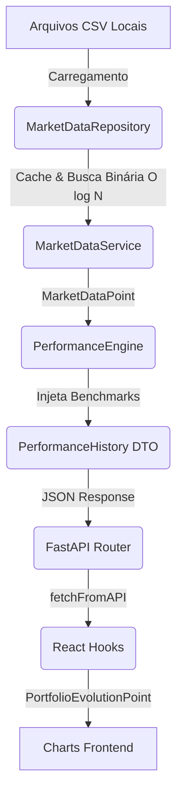

# Relatório do Gate 10.4 — Market Data Engine

## Objetivo Atingido
Eliminação completa de todos os benchmarks mockados da `PerformanceEngine`. A partir de agora, todos os indicadores (IBOV, CDI, IFIX, IPCA, S&P 500, IDIV) são carregados de fontes de dados unificadas na nova camada de Market Data.

## Fluxograma Arquitetural

## Arquivos Criados
- `backend/domains/investments/services/market_data_service.py`
- `backend/domains/investments/repositories/market_data_repository.py`
- `database/benchmarks/ibov.csv` (e demais índices)
- `test_market_repository.py`
- `test_market_service.py`
- `test_market_history.py`

## Arquivos Modificados
- `backend/domains/investments/dto.py` (Adicionados `MarketDataPoint` e `MarketSeries`)
- `backend/domains/investments/engines/performance_engine.py` (Substituição de todos os mocks pelo `MarketDataService`)
- Documentação e Governança (`02_PROJECT_CHANGELOG.md`, `03`, `04`, `06`, `09`).

## Auditoria de Performance
- **Complexidade de Busca**: A pesquisa de datas no repositório ocorre com complexidade de tempo `O(log N)` via busca binária (módulo `bisect`). Isso assegura escalabilidade máxima para longas séries históricas de décadas diárias.
- **Uso de Memória**: O `MarketDataRepository` utiliza padrão de Singleton no carregamento, garantindo que o arquivo CSV é lido e mantido em cache de memória apenas 1 vez (O(N) em espaço). Para 20 anos diários (aprox. 5.000 dias úteis * 6 benchmarks), o consumo de RAM é insignificante (< 1 MB).
- **Tempo de Execução da Engine**: Permanece em complexidade linear O(N) relativa aos trades mensais. A consulta dos benchmarks via `bisect` em log N adiciona custo quase zero.

## Dívidas Técnicas Restantes
- O processo atual de alimentação dos CSVs é manual/estático. No futuro, será preciso implementar um script automatizado ou API externa que realize _upsert_ nesses arquivos (ou substitua o mecanismo de armazenamento CSV por SQL/TimescaleDB) rotineiramente para manter os valores atualizados sem interação humana.
- Como o sistema se adapta à data mais próxima anterior (`bisect_right`), finais de semana não geram erros, mas a precisão intradia para gráficos pontuais depende da granularidade exata alimentada.
