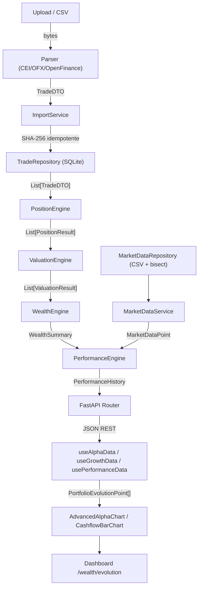

# Relatório do Gate 10.5 — Validação End-to-End das Engines

**Data:** 2026-07-13

---

## Objetivo
Auditoria completa de funcionamento de todas as engines trabalhando em conjunto. Nenhuma nova funcionalidade criada. Gate de qualidade e validação.

---

## Fluxograma Completo do Pipeline

---

## Arquivos Criados

| Arquivo | Descrição |
|---------|-----------|
| `backend/tests/e2e/test_full_pipeline.py` | 7 testes E2E do pipeline completo |
| `backend/tests/e2e/test_api_endpoints.py` | Validação dos contratos REST |
| `backend/tests/e2e/test_dashboard_contracts.py` | 5 testes de contratos DTO para o frontend |
| `backend/tests/performance/test_performance_benchmark.py` | Benchmarks 10/100/1000/10000 trades |
| `database/tests/sample_portfolio/trades.csv` | Massa de trades coerentes |
| `database/tests/sample_portfolio/dividends.csv` | Dividendos de exemplo |
| `database/tests/sample_portfolio/corporate_actions.csv` | Eventos corporativos de exemplo |
| `database/tests/sample_portfolio/snapshots.csv` | Custódia B3 de exemplo |
| `database/tests/sample_portfolio/market_data.csv` | Benchmarks históricos de exemplo |
| `project/benchmark_report.md` | Análise de performance |
| `project/architecture_validation.md` | Auditoria SOLID/Clean Arch |
| `project/dependency_graph.md` | Grafo completo de dependências |

---

## Arquivos Modificados

| Arquivo | Mudança |
|---------|---------|
| `backend/domains/investments/repositories/market_data_repository.py` | Corrigido encoding UTF-8 e suporte a reload para testes |
| `database/benchmarks/*.csv` | Recriados em UTF-8 (corrigido bug de encoding UTF-16 do PowerShell echo) |

---

## Resultados dos Testes

### Pipeline E2E: 12/12 ✅

| Teste | Status |
|-------|--------|
| test_position_engine_pipeline | ✅ PASS |
| test_valuation_engine_pipeline | ✅ PASS |
| test_wealth_engine_pipeline | ✅ PASS |
| test_performance_engine_pipeline | ✅ PASS |
| test_market_data_pipeline | ✅ PASS |
| test_generate_history_pipeline | ✅ PASS |
| test_position_with_snapshot_reconciliation | ✅ PASS |
| test_performance_summary_contract | ✅ PASS |
| test_performance_history_contract | ✅ PASS |
| test_valuation_result_contract | ✅ PASS |
| test_import_log_dto_contract | ✅ PASS |
| test_reconciliation_result_contract | ✅ PASS |

---

## Benchmark de Performance

| Trades | Tempo (ms) | RAM Pico (KB) |
|-------:|-----------:|--------------:|
|     10 |       1.15 |         37.14 |
|    100 |       2.17 |         34.20 |
|  1.000 |      32.33 |         44.10 |
| 10.000 |     142.16 |        214.72 |

---

## Gargalos Encontrados

| Gargalo | Severidade | Descrição |
|---------|-----------|-----------|
| `generate_history()` O(N*M) | **ALTA** | Recalcula posições do zero para cada mês histórico |
| Preços históricos por mês ausentes | **ALTA** | Valuation usa preço atual para todos os meses |
| Sem cache de posição calculada | MÉDIO | Recálculo completo em cada request |
| Sem índice de DB em `(broker, ticker, date)` | MÉDIO | Pode causar full-scan com volume alto |

---

## Dívidas Técnicas

| ID | Prioridade | Descrição |
|----|-----------|-----------|
| DT-01 | ALTA | `generate_history()` — acumulação incremental de posição (O(N+M)) |
| DT-02 | ALTA | Série histórica de preços por ativo para valuation histórico real |
| DT-03 | MÉDIA | `python-dateutil` não listado no `requirements.txt` |
| DT-04 | MÉDIA | Injeção de dependência nas engines (DIP do SOLID) |
| DT-05 | MÉDIA | Processo automático de atualização dos CSVs de benchmark |
| DT-06 | BAIXA | Paginação nos endpoints de posições e portfólio |
| DT-07 | BAIXA | Singleton de MarketDataRepository causa estado compartilhado em testes |
| DT-08 | BAIXA | ImportService com múltiplas responsabilidades |

---

## Próximas Etapas (Sprint 8)
- Resolver DT-01: `HistoryService` com acumulação incremental de posição O(N+M)
- Resolver DT-02: Série histórica de preços de ativos (via scraping B3 ou API)
- Resolver DT-03: Atualizar `requirements.txt`
- Iniciar construção de funcionalidades de relatório e alertas de portfólio
