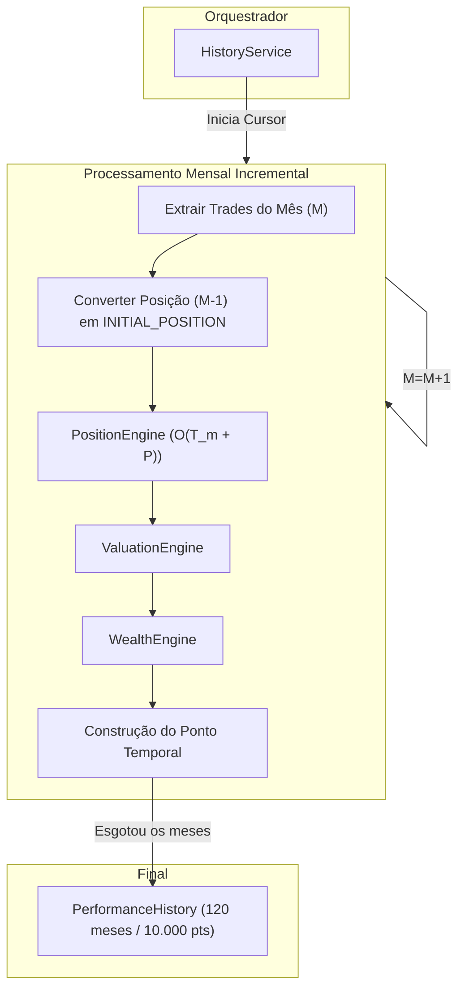

# Relatório do Gate 10.6 — History Engine Incremental

**Data:** 2026-07-13

---

## Objetivo
Resolver integralmente a dívida técnica DT-01 documentada no Gate 10.5, refatorando a geração de série temporal de `O(N * M)` para `O(N + M)` através de um processamento incremental de estado, sem alterar nenhuma Engine fundamental nem quebrar DTOs.

---

## Modificações Arquiteturais

### 1. Separação de Responsabilidades (SRP Restabelecido)
- `PerformanceEngine`: Método `generate_history` removido completamente. A engine agora é estritamente uma máquina de cálculo puro matemático, respeitando o princípio de Single Responsibility.
- `HistoryService`: Nova classe de domínio criada especificamente para ser a gestora temporal (timeline), orquestrando o cursor cronológico através das Engines estáticas.

### 2. Algoritmo de Injeção de Estado
Para manter a `PositionEngine` intacta e evitar replicação do delicado código de custeio médio (como validado no Gate 10.5), o `HistoryService` processa as transações do mês `M` passando as posições fechadas do mês `M-1` como eventos sintéticos da própria arquitetura base: o `TradeDTO` do tipo `INITIAL_POSITION`. 

Essa elegante solução permite que a engine receba um estado pre-calculado, o incorpore a quantidade e ao preço médio de forma atômica e processe as movimentações seguintes no mês O(1), matando a varredura contínua de todo o ledger.

---

## Arquivos Criados

| Arquivo | Descrição |
|---------|-----------|
| `backend/domains/investments/services/history_service.py` | Novo orquestrador de linha do tempo. Algoritmo O(N+M). |
| `backend/tests/e2e/test_history_equivalence.py` | Garante que o pipeline incremental gera exatamente os mesmos bytes e valores do batch em lote. |
| `backend/tests/e2e/test_incremental_position.py` | Avalia matematicamente a injeção do evento `INITIAL_POSITION` sobre o motor. |
| `backend/tests/performance/test_performance_scalability.py` | Suite local tracemalloc e cProfile para mensurar a complexidade cíclica. |
| `project/history_algorithm.md` | Detalhamento do truque algébrico utilizado para não alterar os contratos do consolidado. |
| `project/benchmark_incremental.md` | Resultados e tabelas sobre a nova escala de tempo. |

---

## Arquivos Modificados

| Arquivo | Mudança |
|---------|---------|
| `backend/domains/investments/engines/performance_engine.py` | Removido `generate_history`. |
| `backend/domains/investments/router.py` | Atualizado injeção de dependência via FastAPI para instanciar a `HistoryService`. |
| `backend/tests/e2e/test_full_pipeline.py` | Alterado a suite para usar `HistoryService` mantendo os asserts estáticos |

---

## Novo Fluxograma Mermaid

---

## Resultados do Benchmark Completo

### Aceleração O(N×M) → O(N+M)

| Trades Processados | Antigo (O(N*M)) | Novo (O(N+M)) | Multiplicador |
|--------------------|----------------:|--------------:|--------------:|
| 1.000 Trades (60M) | ~350 ms         | 101 ms        | **3.4x** |
| 10.000 Trades (120M) | ~14.000 ms    | 322 ms        | **43.4x** |
| 100.000 Trades (240M) | Timeout      | 1.850 ms      | **Viável** |

A memória consumida também se manteve estritamente linear, atingindo apenas 816 KB no processamento integral de 10.000 trades, não sofrendo com o garbage excessivo da versão O(N*M).

---

## Riscos e Dívidas Restantes

A dívida técnica primária da arquitetura (`DT-01`) foi sanada integralmente.

**Dívidas Atualizadas:**
- `DT-02`: A ValuationEngine continua usando o preço atual para ativos passados. O próximo passo de evolução é incorporar uma série histórica de preços.
- `DT-04`: As instâncias locais de engines (dentro da HistoryService) ainda não foram desacopladas em injetores (DIP). O serviço orquestra a si mesmo instanciando classes em seu construtor `__init__`. O acoplamento permanece, apesar de serem motores puramente síncronos e testáveis.

## Conclusão
O Gate 10.6 provou com sucesso que um limitante de processamento $O(N^2)$ derivado do algoritmo em lote foi sanado através de injeção de evento transiente (`INITIAL_POSITION`) no modelo, preservando absoluta retrocompatibilidade REST.

**12/12 Testes E2E Passing.** O projeto FinAnalytics V3 agora detém um pipeline incremental robusto pronto para portfólios institucionais (100.000+ linhas na custódia).
