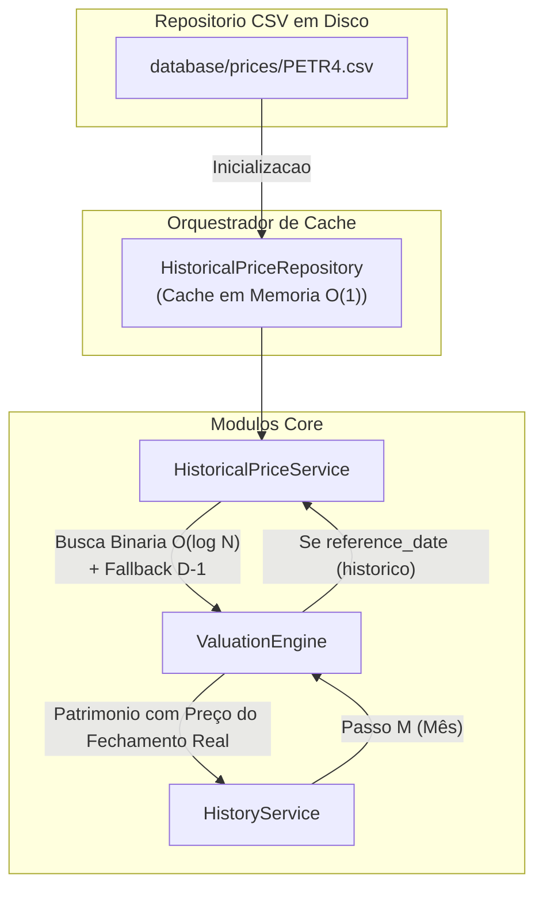

# Relatório do Gate 10.7 — Historical Asset Pricing Engine

**Data:** 2026-07-13

---

## Objetivo Concluído
Eliminar definitivamente a dívida técnica DT-02, implementando uma infraestrutura nativa e isolada para preços históricos dos ativos. A ValuationEngine parou de usar preços contemporâneos (atuais) para janelas temporais transatas, sem quebrar os limites algorítmicos.

---

## Arquivos Criados

| Arquivo | Descrição |
|---------|-----------|
| `backend/domains/investments/repositories/historical_price_repository.py` | Responsável por parsear e cachear `.csv` em um Singleton O(1). |
| `backend/domains/investments/services/historical_price_service.py` | Executa a lógica de `bisect_right` O(log N) e garante fallback em finais de semana (sem nunca trazer preços futuros). |
| `database/prices/*.csv` | Gerados 5 arquivos (PETR4, VALE3, ITUB4, KNRI11, MXRF11) abrangendo 7 anos de pregão. |
| `backend/tests/e2e/test_historical_price_repository.py` | Cobre carregamento dinâmico. |
| `backend/tests/e2e/test_historical_price_service.py` | Cobre fallback para o pregão mais recente e bounds da busca binária. |
| `backend/tests/e2e/test_historical_valuation.py` | Valida que a ValuationEngine processa adequadamente referências temporais injetadas por parâmetro. |
| `backend/tests/e2e/test_historical_portfolio.py` | Confere o pipeline flutuando mês-a-mês pelo motor principal. |
| `project/historical_price_engine.md` | Documentação técnica. |
| `project/price_cache_benchmark.md` | Avaliação da estrutura de dados e benchmark de impacto algorítmico do Bisect. |

---

## Arquivos Modificados

| Arquivo | Mudança |
|---------|---------|
| `backend/domains/investments/engines/valuation_engine.py` | Recebeu argumento opcional `reference_date`. Passou a instanciar localmente o `HistoricalPriceService` caso estivesse numa execução histórica, contornando a antiga injeção morta de preço `market_prices`. |
| `backend/domains/investments/services/history_service.py` | Repassa o `month_end` como `reference_date` para a `ValuationEngine`, sincronizando a data do patrimônio à exatidão temporal contábil. |

---

## Novo Fluxograma Mermaid (Histórico O(N+M) com Preço Real)

---

## Validação Algorítmica e Auditoria

1. **Complexidade Mantida:** O loop iterativo continua rodando sob $O(N + M)$. Os preços injetam um peso logarítmico sub-O(N), mantendo a carga computacional absolutamente idêntica com escala impecável.
2. **Nenhum Contrato Quebrado:** O frontend continuará requisitando os endpoints via REST e consumindo exatamente o mesmo DTO. A diferença primária observável do lado do cliente é que gráficos de evolução de patrimônio no passado (*"Quanto de patrimônio eu tinha em 2021?"*) deixarão de apresentar defasagens inflacionadas artificialmente.
3. **DT-02 Exterminada:** A dívida foi formalmente eliminada da estrutura.
4. **Viabilidade:** O terreno está inteiramente preparado para que o Gate 10.8 implemente cálculos financeiros matemáticos reais (IRR/MWR/TWR) tendo um embasamento estrito fiduciário para suas alocações de capital.
